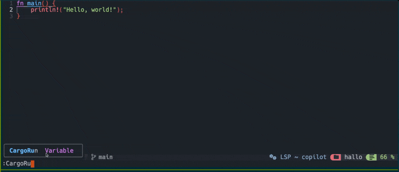

# 🚀 cargo.nvim

[](https://github.com/nwiizo/cargo.nvim/actions/workflows/rust.yml)
[](https://github.com/nwiizo/cargo.nvim/actions/workflows/lua.yml)

---

📦 A Neovim plugin that provides seamless integration with Rust's Cargo commands. Execute Cargo commands directly from Neovim with a floating window interface.



## ✨ Features

- 🔧 Execute Cargo commands directly from Neovim
- 🪟 Real-time output in floating windows
- 🎨 Syntax highlighting for Cargo output
- ⚡ Asynchronous command execution
- 🔄 Auto-closing windows on command completion
- ⌨️ Easy keyboard shortcuts for window management
- 📟 Terminal mode for interactive applications

## 🎯 Scope

cargo.nvim is a faithful front-end to the `cargo` CLI inside Neovim: it runs Cargo
subcommands and shows their streamed output in a readable window, including
interactive programs (via terminal mode). It is intentionally a *command runner and
report viewer*, not a language-intelligence layer.

It complements, rather than replaces, the LSP-based Rust tooling you may already use:

- **rust-analyzer / [rustaceanvim](https://github.com/mrcjkb/rustaceanvim)** — inline diagnostics, jump-to-error, hover, macro expansion, code actions, runnables/testables.
- **[crates.nvim](https://github.com/saecki/crates.nvim)** — editing dependencies inside `Cargo.toml`.
- **[neotest](https://github.com/nvim-neotest/neotest)** — structured test running and navigation.

If you run those, cargo.nvim is most useful for the Cargo subcommands they don't
surface (e.g. `audit`, `outdated`, `tree`, `vendor`, `publish`, `doc`, `bench`) and
for running interactive programs. Overlapping commands such as `check`, `clippy`,
`test`, and `run` remain available for backward compatibility, but the LSP/neotest
equivalents generally offer a richer experience.

## 📑 Table of Contents

- [🚀 cargo.nvim](#-cargonvim)
  - [✨ Features](#-features)
  - [🎯 Scope](#-scope)
  - [📑 Table of Contents](#-table-of-contents)
  - [📥 Installation](#-installation)
    - [Using lazy.nvim](#using-lazynvim)
    - [Using packer.nvim](#using-packernvim)
  - [📋 Requirements](#-requirements)
    - [Troubleshooting](#troubleshooting)
  - [🛠️ Available Commands](#️-available-commands)
  - [⚙️ Configuration](#️-configuration)
  - [⌨️ Key Mappings](#️-key-mappings)
  - [🔄 Interactive Mode](#-interactive-mode)
  - [📟 Terminal Mode](#-terminal-mode)
  - [🧪 Development](#-development)
  - [👥 Contributing](#-contributing)
  - [📜 License](#-license)
  - [💝 Acknowledgements](#-acknowledgements)
  - [🎉 Related Projects](#-related-projects)

## 📥 Installation

### Using [lazy.nvim](https://github.com/folke/lazy.nvim)

```lua
{
  "nwiizo/cargo.nvim",
  build = "cargo build --locked --release",
  config = function()
    require("cargo").setup({
      window_width = 0.8,
      window_height = 0.8,
      border = "rounded",
      auto_close = true,
      close_timeout = 5000,
    })
  end,
  ft = { "rust" },
  cmd = {
    "CargoBench",
    "CargoBuild", 
    "CargoClean",
    "CargoDoc",
    "CargoNew",
    "CargoRun",
    "CargoRunTerm",
    "CargoTest",
    "CargoUpdate",
    "CargoCheck",
    "CargoClippy",
    "CargoAdd",
    "CargoRemove",
    "CargoFmt",
    "CargoFix"
  }
}
```

### Using [packer.nvim](https://github.com/wbthomason/packer.nvim)

```lua
use {
  "nwiizo/cargo.nvim",
  run = "cargo build --locked --release",
  config = function()
    require("cargo").setup({
      window_width = 0.8,
      window_height = 0.8,
      border = "rounded",
      auto_close = true,
      close_timeout = 5000,
    })
  end,
}
```

## 📋 Requirements

- 💻 Neovim >= 0.9.0
- 🦀 Rust and Cargo >= 1.97

The native module uses Neovim's embedded LuaJIT at runtime. Building it does not
require separate Lua or LuaJIT headers and libraries. The repository includes the
linker configuration required for module builds on macOS.

### Troubleshooting

If you see "Cargo library not found" error after installation:

1. **Check your Rust version:**
   ```bash
   rustc --version
   ```
2. **Rebuild the library manually:**
   ```bash
   cd ~/.local/share/nvim/lazy/cargo.nvim  # or your plugin directory
    cargo build --locked --release
   ```
3. **Verify the library was built:**
   ```bash
   ls -la target/release/libcargo_nvim.*
   # Should show libcargo_nvim.so (Linux) or libcargo_nvim.dylib (macOS)
   ```

If the build still fails, run it again with `RUST_BACKTRACE=1` and include the
complete Cargo error when opening an issue.

## 🛠️ Available Commands

### Core Commands
- 📊 `:CargoBench` - Run benchmarks
- 🏗️ `:CargoBuild` - Build the project
- 🧹 `:CargoClean` - Remove generated artifacts 
- 📚 `:CargoDoc` - Generate project documentation
- ✨ `:CargoNew` - Create a new Cargo project
- ▶️  `:CargoRun` - Run the project in a floating window
- 📟 `:CargoRunTerm` - Run the project in terminal mode (better for interactive applications)
- 🧪 `:CargoTest` - Run tests
- 🔄 `:CargoUpdate` - Update dependencies

### Additional Commands
- 🔍 `:CargoCheck` - Check the project for errors
- 📋 `:CargoClippy` - Run the Clippy linter
- ➕ `:CargoAdd` - Add dependency
- ➖ `:CargoRemove` - Remove dependency
- 🎨 `:CargoFmt` - Format code with rustfmt
- 🔧 `:CargoFix` - Auto-fix warnings
- 📦 `:CargoPublish` - Publish package
- 📥 `:CargoInstall` - Install binary
- 📤 `:CargoUninstall` - Uninstall binary
- 🔎 `:CargoSearch` - Search packages
- 🌲 `:CargoTree` - Show dependency tree
- 📦 `:CargoVendor` - Vendor dependencies
- 🛡️ `:CargoAudit` - Audit dependencies
- 📊 `:CargoOutdated` - Check outdated dependencies
- 🤖 `:CargoAutodd` - Automatically manage dependencies

## ⚙️ Configuration

You can customize cargo.nvim by passing options to the setup function:

```lua
require("cargo").setup({
  -- Window settings
  window_width = 0.8,           -- Window width (80% of editor width)
  window_height = 0.8,          -- Window height (80% of editor height)
  border = "rounded",           -- Border style ("none", "single", "double", "rounded")
  wrap_output = true,           -- Enable text wrapping in output window
  show_line_numbers = true,     -- Show line numbers in output window
  show_cursor_line = true,      -- Highlight current line in output window
  
  -- Auto-close settings
  auto_close = true,            -- Auto close window on success
  close_timeout = 30000,        -- Close window after 30 seconds
  poll_interval = 50,           -- Poll streamed output every 50ms
  
  -- Key mappings (customizable)
  keymaps = {
    close = "q",
    scroll_up = "<C-u>",
    scroll_down = "<C-d>",
    scroll_top = "gg",
    scroll_bottom = "G",
    interrupt = "<C-c>",
    send_input = "i",    -- Send a line to the program's stdin
    toggle_wrap = "w",
    copy_output = "y",
    clear_output = "c",
  },
})
```

### Custom Commands

The `commands` table is extensible: add an entry to register a new `:Cargo*`
command from your configuration alone — no rebuild required. Each entry may set
`cmd` (the actual Cargo subcommand, defaults to the key) and `args` (arguments
prepended before any you type):

```lua
require("cargo").setup({
  commands = {
    -- :CargoTestRelease -> `cargo test --release`
    testRelease = { cmd = "test", args = { "--release" }, desc = "Run tests in release mode" },
    -- :CargoNextest -> `cargo nextest run`
    nextest = { cmd = "nextest", args = { "run" }, desc = "Run tests with nextest" },
  },
})
```

The key becomes the command name (`testRelease` → `:CargoTestRelease`). When
`nargs` is omitted it defaults to `"*"`, so extra arguments are still accepted.

## ⌨️ Key Mappings

In the floating window:
- `q` or `<Esc>` - Close the window
- `<C-c>` - Interrupt the running command
- `i` - Send a line to the program's stdin
- `<C-u>` - Scroll up
- `<C-d>` - Scroll down
- `gg` - Scroll to top
- `G` - Scroll to bottom
- `w` - Toggle text wrapping
- `y` - Copy all output to clipboard
- `c` - Clear output

## 🔄 Interactive Mode

Commands run asynchronously: output is streamed into the floating window as it is
produced, and you stay in control of the editor while a command runs.

For programs that read from stdin:
- Press `i` in the output window to be prompted for a line of input, which is
  sent to the running program's stdin.
- Press `<C-c>` to interrupt (terminate) the running command at any time.

For terminal-style programs that need a full TTY (e.g. `proconio`, TUIs), prefer
[Terminal Mode](#-terminal-mode) below.

## 📟 Terminal Mode

For highly interactive applications (e.g., using proconio or TUI applications):
- Use `:CargoRunTerm` to run your application in a terminal emulator inside a floating window
- Supports full terminal capabilities for interactive Rust applications
- Useful for:
  - Competitive programming with libraries like proconio
  - Text-based UI applications
  - Programs requiring advanced terminal input/output
- Provides a better experience than the standard `:CargoRun` for interactive applications

### Terminal Mode Key Mappings
- `q` or `<Esc>` - Close the window (after program completion)
- `<C-\><C-n>` - Switch to normal mode (while running)
- `<C-c>` - Send interrupt signal
- `<C-d>` - Send EOF signal

## 🧪 Development

Run the same checks used by CI:

```bash
cargo fmt --all -- --check
cargo clippy --locked --all-targets -- -D warnings
cargo test --locked
stylua --check lua plugin tests
luacheck lua plugin tests
cargo build --locked --release
nvim --headless -u NONE -l tests/integration.lua
```

`cargo test` covers the Rust job backend. The headless Neovim test loads the
compiled module in its real LuaJIT host and covers command registration,
configuration, streaming output, and terminal execution.

## 👥 Contributing

Contributions are welcome! Please feel free to submit a Pull Request.

1. 🍴 Fork the repository
2. 🌿 Create a feature branch
3. ✍️ Commit your changes
4. 🚀 Push to the branch
5. 📫 Open a Pull Request

## 📜 License

MIT License - see the [LICENSE](LICENSE) file for details.

## 💝 Acknowledgements

This plugin is inspired by various Neovim plugins and the Rust community.

## 🎉 Related Projects

- [cargo-autodd](https://github.com/nwiizo/cargo-autodd) - A tool for automatic dependency management
